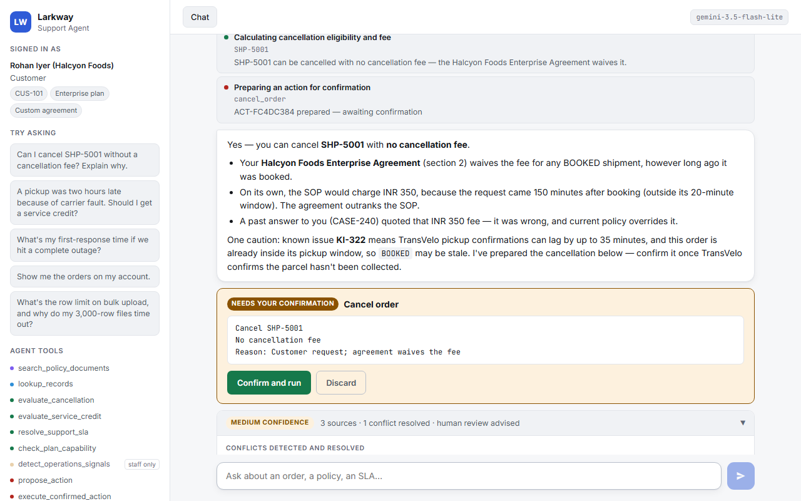
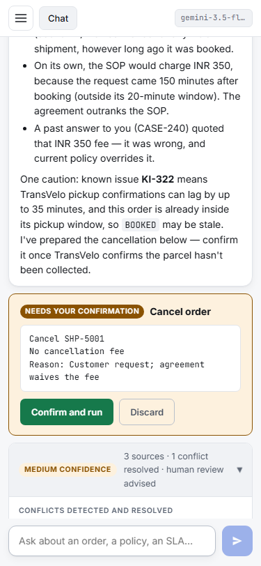
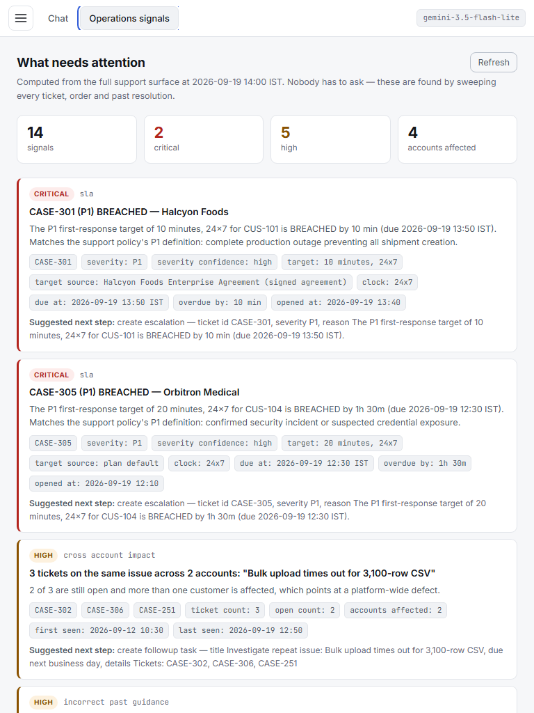
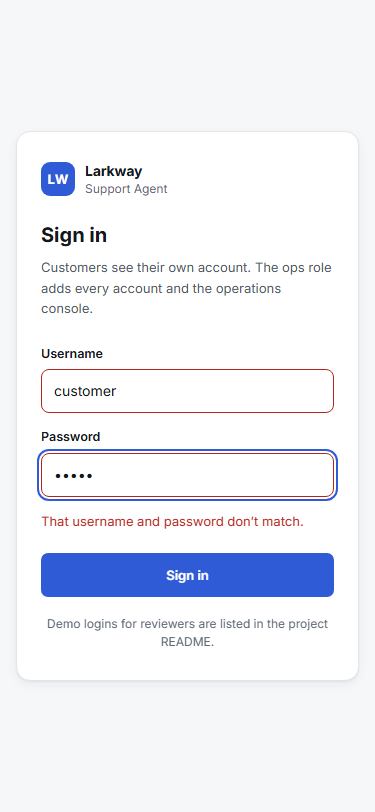

# Larkway Support Agent

**Live demo: [larkway-support-agent.vercel.app](https://larkway-support-agent.vercel.app)** —
sign in with one of the [demo logins](#demo-logins-for-reviewers) and ask away.

**Stack:** React + TypeScript (Vite) frontend · FastAPI backend with JWT auth and
role checks · deterministic policy engine · Claude or any OpenAI-compatible model ·
deployed on Vercel.

An AI support agent for **Larkway**, a fictional B2B shipping platform. One codebase
serves two user contexts:

- a **customer-facing agent** that answers entitlement questions about orders,
  cancellations, service credits and support SLAs, and escalates what it should not
  decide alone, and
- an **internal support/operations console** that investigates across accounts and
  surfaces what needs attention before anyone asks.

The source material is deliberately imperfect: a deprecated policy that still reads as
authoritative, customer contracts that override the general rules, and closed tickets
whose recorded answers are simply wrong. The design premise is that **a support agent's
hardest job is not retrieval, it is deciding which source wins** — so that is where most
of the engineering went.

### Demo logins (for reviewers)

| Role | Username | Password | Sees |
|---|---|---|---|
| Customer | `customer` | `larkway-customer-demo` | Halcyon Foods' own account, chat only |
| Ops | `ops` | `larkway-ops-demo` | every account, plus the operations console |

These are public demo credentials for a fictional dataset. Only their scrypt hashes are
in the code, and a session token lasts 30 minutes.

### Screenshots

| Customer chat (desktop) | Customer chat (mobile, 375px) |
|---|---|
|  |  |

| Operations console (tablet, 768px) | Sign in (mobile) |
|---|---|
|  |  |

---

## What it does that a thin RAG wrapper does not

| | |
|---|---|
| **The model never does the money maths** | Fees, credits and SLA deadlines are computed by a deterministic policy engine against rules extracted from the documents. Same question, same answer, every time — and unit-testable without an API key. |
| **The rules cannot drift from the documents** | Every rule in the policy pack carries the verbatim clause it came from, and a verifier re-reads the PDFs and asserts each quote is still there. It runs on startup and in the tests. |
| **Retrieval ranks on authority, not just similarity** | Signed agreement > current policy/SOP > product docs > historical tickets. Deprecated documents are excluded from answers and reported separately so a conflict can be *named*. |
| **Access control is in the data layer** | Identity comes from a short-lived JWT (OAuth2 password flow, scrypt-hashed passwords), never from a tool argument or the request body. A customer cannot read another account's rows, columns, or contract, and the ops console checks the role in FastAPI — proven by tests, not by prompt instructions or a hidden button. |
| **Confirmation is unforgeable** | The confirm flag can only be set by an HTTP endpoint behind a real button click. The model has no tool that sets it, so "ask before acting" is a property of the system. |
| **It finds problems nobody reported** | The operations sweep flags SLA breaches against each account's own contract, cross-account issues, credits owed that nobody claimed, and **past answers that current policy contradicts**. |
| **Model-agnostic** | Runs on Claude or any OpenAI-compatible endpoint — including free tiers (Groq, Gemini) and a local Ollama. None of the guarantees above live in the model. |

Two things hidden in the data that the system gets right:

- **The snapshot is a Saturday.** A ticket opened at 16:30 on Friday against a
  2-business-hour target has used 90 minutes, not 21 hours — it is *at risk*, not
  breached. A wall-clock calculation gets this wrong.
- **Two customers were previously given wrong answers.** CASE-240 quoted Halcyon Foods
  a fee their contract waives; CASE-251 told Brightmoor their plan caps at 2,500 rows
  when that is really bug KI-314. Both are surfaced automatically.

---

## Quick start

Needs Python 3.10+ and Node.js 20.19+ (22 recommended).

```bash
python -m venv .venv
source .venv/bin/activate          # Windows: .venv\Scripts\activate
pip install -r requirements.txt
cp .env.example .env               # add a model key (a free Groq key works)

cd frontend && npm ci && npm run build && cd ..   # React build -> public/
uvicorn app.main:app --reload
```

Open <http://localhost:8000> and sign in with a [demo login](#demo-logins-for-reviewers).
Set `LARKWAY_JWT_SECRET` in `.env` to keep sessions across restarts; without it, local
runs use a random per-process secret and print a warning.

**Frontend development** with hot reload: run the backend on port 8000 as above, then
`cd frontend && npm run dev` and open <http://localhost:5173> — Vite proxies `/api` to
FastAPI.

### Choosing a model (free options included)

| Provider | Cost | Settings in `.env` |
|---|---|---|
| **Groq** | Free tier | `PP_PROVIDER=openai_compat`, `PP_BASE_URL=https://api.groq.com/openai/v1`, `PP_API_KEY`, `PP_MODEL=openai/gpt-oss-120b` |
| **Gemini** (Google AI Studio) | Free tier | `PP_BASE_URL=https://generativelanguage.googleapis.com/v1beta/openai/`, a Gemini key, `PP_MODEL=gemini-3.5-flash-lite` |
| **Ollama** | Free, local | `PP_BASE_URL=http://localhost:11434/v1`, no key |
| **Claude** | Paid API | `PP_PROVIDER=anthropic`, `ANTHROPIC_API_KEY` |

`.env.example` has each block ready to uncomment. Swapping the model changes nothing
that matters for trust: the numbers come from the policy engine, scope comes from the
server session, and confirmation needs a click.

### Tested providers

The 16 golden scenarios run live (`python -m evals.run --live`), with no fallback
models, so each row is one model's own result.

| Provider | Model | Date | Scenarios passed | The misses |
|---|---|---|---|---|
| Groq (free tier) | `openai/gpt-oss-120b` | 2026-10-21 | **16 / 16** | — |
| Gemini (AI Studio, free tier) | `gemini-3.5-flash-lite` | 2026-10-21 | **16 / 16** | — (one scenario re-run after the free tier's 15-requests-per-minute limit) |
| Gemini (AI Studio, free tier) | `gemini-3.5-flash` | 2026-10-19 | 6 / 6 run, 10 not run | Free tier allows 20 requests per model per day; the cap ran out mid-run. |

Gemini-specific handling confirmed live: free-form tool arguments travel as JSON
strings, and thought signatures are echoed back across multi-step tool turns. Free-tier
Gemini models can be briefly unavailable under load (`503 high demand`) — on the test
day `gemini-3.8-flash` was.

### Without a model

Chat needs one of the providers above. **Everything else still works** — the operations
dashboard, the policy engine, retrieval, the access-control layer, the test suite and
the offline eval harness. The UI says so plainly rather than failing silently.

### Deploying to Vercel

`vercel.json` does both halves: it installs and builds the React app
(`cd frontend && npm ci && npm run build`, output in `public/`, served from Vercel's CDN)
and deploys FastAPI as a single Python function that receives `/api/*`. `.vercelignore`
keeps secrets, virtualenvs, `node_modules` and local build output out of the upload.
With the GitHub repo connected, every push to `main` deploys; `vercel deploy --prod`
also works from a local checkout.

Environment variables in the Vercel project:

| Variable | Required | |
|---|---|---|
| `LARKWAY_JWT_SECRET` | **yes** | Long random string that signs session tokens. Without it, login refuses with a clear 503 rather than signing tokens with a per-instance secret. |
| `PP_PROVIDER`, `PP_BASE_URL`, `PP_MODEL`, `PP_API_KEY` | for chat | The model provider. Without them the app runs with chat disabled. |
| `PP_FALLBACK_MODELS`, `LARKWAY_TOKEN_MINUTES` | no | See [Configuration](#configuration). |

Conversations and pending actions live in memory, so a cold start begins a fresh
session — fine for a demo; a real deployment would put them in Redis.

### Using the tools from Claude Code (MCP)

`app/mcp_server.py` exposes the agent's tools over the Model Context Protocol (stdio
transport), so an MCP client such as Claude Code can call them directly. It is a thin
adapter over the same tool layer the chat agent uses, so every guarantee carries over:

- **Identity is set when the server starts**, from `LARKWAY_MCP_USER` — never from a
  tool argument. The default is `cust-halcyon`, a **customer**: one account, internal
  columns stripped, no operations sweep. Staff access is an explicit opt-in
  (`staff-meera` or `staff-kavya`).
- **Scope is enforced in the data layer**, exactly as in the web app; another account's
  records come back as an `access_denied` tool error.
- **Nothing executes.** `propose_action` only records a pending proposal, and
  `execute_confirmed_action` is not exposed: confirming needs a person's click in the
  web app.

Run it directly (it speaks MCP on stdin/stdout, so it waits silently for a client):

```bash
python -m app.mcp_server
```

Register it in Claude Code, using the project's virtualenv Python and the launcher in
`scripts/`, which works from any directory. Replace `<repo>` with the absolute path of
your clone (e.g. `E:/CalQuity/parcelpilot-agent`); on macOS/Linux the Python is
`<repo>/.venv/bin/python`.

```bash
claude mcp add --transport stdio larkway -- <repo>/.venv/Scripts/python.exe <repo>/scripts/mcp_server.py

# Or as staff. Keep another option between --env and the name, or the CLI reads the
# name as a second KEY=value pair.
claude mcp add --env LARKWAY_MCP_USER=staff-meera --transport stdio larkway-staff -- <repo>/.venv/Scripts/python.exe <repo>/scripts/mcp_server.py
```

Check it with `claude mcp list` (look for `✔ Connected`) or `/mcp` inside Claude Code.

**Example.** Ask Claude Code *"Using the larkway tools, can SHP-5001 be cancelled without
a fee?"* It calls `evaluate_cancellation` with `{"order_id": "SHP-5001"}` and gets the
policy engine's decision back (abridged):

```json
{
  "outcome": "cancellable_no_fee",
  "summary": "SHP-5001 can be cancelled with no cancellation fee — the Halcyon Foods Enterprise Agreement waives it.",
  "facts": { "fee_inr": 0, "default_fee_inr": 350, "fee_waived_by_agreement": true },
  "requires_human_review": true,
  "caveats": ["KI-322: TransVelo pickup webhooks can lag by up to 35 minutes, and this order is already inside its pickup window. BOOKED may be stale — …"]
}
```

---

## Try it

Sign in with a [demo login](#demo-logins-for-reviewers); each role sees a genuinely
different system.

**As `customer` — Rohan Iyer, Halcyon Foods (Enterprise, custom contract)**
> Can I cancel SHP-5001 without a cancellation fee? Explain why.

Chains several tools, finds that the SOP would charge INR 350 but the signed agreement
waives it, flags that CASE-240 told this customer the opposite, and warns that KI-322
makes the `BOOKED` status unreliable for TransVelo inside the pickup window — so it asks
for carrier verification before cancelling.

> A pickup was two hours late because of carrier fault. Do I get a service credit? The
> shipment fee was INR 3,600.

**INR 540** — the SOP's 90-minute threshold is met and the credit is the lower of
INR 600 or 15% of the fee.

> Show me the orders for Orbitron Medical.

Refused in the data layer — and the operations console isn't there for this role at all;
calling its endpoint directly returns 403.

**As `ops` — Kavya Nair, Support Manager**
> A Brightmoor Textiles pickup was two hours late because of carrier fault. Is a credit owed?

**No** — Brightmoor's contract replaces the SOP's 90-minute threshold with 3 hours. The
same facts gave Halcyon Foods INR 540. Contract-specific, not policy-generic.

> What needs my attention right now?

14 signals: two breached P1s, a bulk-upload issue hitting two customers, two customers
given wrong advice, and an INR 2,000 credit owed that nobody has claimed (and that needs
a manager's approval). Also available as the **Operations signals** tab.

---

## Verify the claims

```bash
pytest -q                          # 113 tests, no API key needed
python -m evals.run                # 16 golden scenarios, offline
python -m evals.run --live         # also drives the real agent and checks its prose
python scripts/verify_policy_pack.py

cd frontend
npm run lint                       # oxlint, incl. jsx-a11y and React hooks rules
npm run typecheck                  # tsc -b
npm test                           # 43 Vitest + React Testing Library tests
npm run build
npm run check:browser              # Playwright: axe scans + 375/768/1280px layouts
```

The Python suite covers the entitlement maths, the access-control boundary, JWT login
and role checks, the confirmation gate, both model backends, and the agent loop itself
(driven by a scripted model, so the loop wiring is verified without a key). The
frontend tests cover the typed API client, streaming, the confirmation card, the trust
panel, the ops console and role gating. The browser checks need
`npx playwright install chromium` once, and `LARKWAY_PYTHON` pointing at the venv's
Python (e.g. `../.venv/Scripts/python.exe`) so Playwright can start the backend.

---

## Architecture at a glance

```
React + TypeScript (Vite): login · chat · tool trace · trust panel · ops console
   │  typed API client — JSON + SSE, Authorization: Bearer <JWT>
FastAPI ── JWT auth + role checks ── audit log (background task) ──┐
   │                                                        │
Agent loop (Claude or any OpenAI-compatible model)          │ /api/actions/{id}/confirm
   │  principal injected server-side                        │ ← the only path that can
   ▼                                                        │   mark an action confirmed
Tool layer ── access control ── audit                       │
   │                                                        │
   ├── Retrieval ....... BM25 + authority re-rank + conflict detection
   ├── Structured data . row scoping + column redaction
   ├── Policy engine ... deterministic decisions + citations ◄─┐
   ├── Ops detector .... proactive signals ────────────────────┘ same engine
   └── Action store .... two-phase confirm ────────────────────┘
                                                            │
Policy pack (YAML rules + verbatim quotes) ◄── verified against ── Source PDFs
```

Full detail in **[ARCHITECTURE.md](ARCHITECTURE.md)**. Product reasoning, what was left
out, and the success metric in **[PRODUCT.md](PRODUCT.md)**.

---

## Project layout

```
app/
  config.py            tunables, paths, provider selection
  access.py            Principal, roles, capabilities, redaction rules
  store.py             workbook -> scoped, redacted reads
  actions.py           state-changing actions + the confirmation gate
  timeutil.py          business-hours arithmetic (the weekend problem)
  ingest/documents.py  PDF -> authority-tagged sections
  policy/pack.py       policy-as-code loader + quote verifier
  policy/engine.py     cancellation, service credit, SLA, plan capability
  policy/severity.py   P1/P2/P3 classification against the policy's own definitions
  retrieval/index.py   BM25 + authority re-rank
  retrieval/conflicts.py  disagreement detection
  signals/detector.py  proactive operations sweep
  agent/tools.py       the 9 tools + authorisation
  agent/providers.py   model backends (Anthropic, OpenAI-compatible)
  agent/loop.py        agent loop
  agent/prompts.py     system prompts
  auth.py              JWT login (OAuth2 password flow), role dependencies
  main.py              FastAPI app: auth, chat (SSE), actions, ops, static frontend
  mcp_server.py        the same tools over MCP (stdio)
frontend/              React + TypeScript (Vite)
  src/api/             typed API client, SSE parser, response types
  src/auth/            session handling (sessionStorage, auto sign-out on expiry)
  src/components/      login, workspace, chat, confirmation card, trust panel, ops
  e2e/                 Playwright: axe scans, responsive layouts, screenshots
api/index.py           Vercel entry point
docs/screenshots/      README screenshots (from the Playwright run)
data/
  source_docs/         the six policy and contract PDFs
  policy_pack/         extracted rules + their source quotes
  larkway_dataset.xlsx accounts, orders, tickets
scripts/
  generate_dataset.py  regenerates the fictional dataset
  mcp_server.py        MCP launcher that works from any directory
evals/  tests/
```

---

## The dataset

Everything in `data/` is fictional and generated by `scripts/generate_dataset.py`:
four customer accounts on three plans, seven orders across four carriers, eight
tickets, a current and a deprecated support policy, a cancellation & credit SOP, a
product guide with known issues, and two signed customer agreements. The traps are
deliberate — contracts that override the SOP, a stale shipment status, a weekend
snapshot, and wrong answers in the ticket history.

To change it, edit the generator and run:

```bash
pip install -r requirements-dev.txt
python scripts/generate_dataset.py
python -m app.ingest && python scripts/verify_policy_pack.py
```

---

## Configuration

| Variable | Default | Notes |
|---|---|---|
| `PP_PROVIDER` | `anthropic` | `anthropic` or `openai_compat`. |
| `ANTHROPIC_API_KEY` | — | Claude only. |
| `PP_BASE_URL` / `PP_API_KEY` | — | `openai_compat` only. Ollama needs no key. |
| `PP_MODEL` | `claude-opus-5` / `gemini-3.8-flash` | Default depends on the provider. |
| `PP_FALLBACK_MODELS` | — | `openai_compat` only. Comma-separated models tried when the main one is rate-limited — free tiers cap tokens per model, so this keeps a demo answering. A fallback answers real users too, so list only models that pass the live evals: `gpt-oss-20b` was dropped after it answered a credit question from the SOP and missed the customer's contract threshold. |
| `PP_EFFORT` | `high` | Claude only. `low`…`max`. |
| `PP_MAX_TOKENS` | `8000` | |
| `PP_MAX_AGENT_STEPS` | `10` | Safety stop on runaway tool loops. |
| `PP_REFUSAL_FALLBACK` | `true` | Claude only. Server-side fallback if the model declines; downgrades itself if the beta is not enabled on the key. |
| `LARKWAY_JWT_SECRET` | — | Signs session tokens. Required on Vercel; locally a random per-process secret is used if unset. |
| `LARKWAY_TOKEN_MINUTES` | `30` | Session token lifetime. |

## Assumptions

Stated in full in [ARCHITECTURE.md](ARCHITECTURE.md#assumptions), and surfaced in the UI
wherever an answer depends on one. The two that matter most:

1. **Business hours are Mon–Fri 09:00–18:00 IST.** The documents never define them, but
   "business hours" and "business days" appear throughout the SLA tables.
2. **An unqualified duration runs on the wall clock.** The support policy distinguishes
   "90 minutes" from "3 business hours" in the same table, so the distinction is treated
   as meaningful.
